

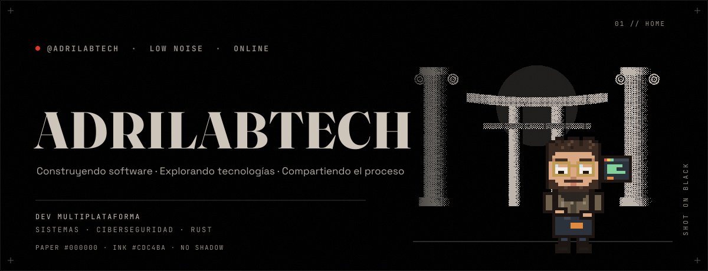

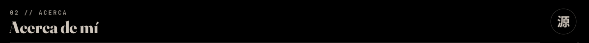

Soy **Adrián**, desarrollador de aplicaciones multiplataforma interesado en sistemas, ciberseguridad y nuevas tecnologías.

**AdriLabTech** es donde convierto mis ideas en proyectos, experimento con documentación y tecnologías nuevas, y aprendo. Disfruto construyendo cosas que me hagan pensar en la tecnología desde perspectivas distintas.

> *"El código es como el humor. Cuando tienes que explicarlo, es malo."*
> — Cory House

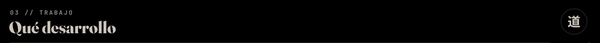

Trabajo en distintas áreas de la tecnología: desde aplicaciones para móviles y escritorio hasta herramientas de sistemas y seguridad de software.

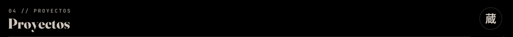

<table>
  <tr>
    <td width="50%"><a href="https://github.com/AdriLabTech/sysTUI">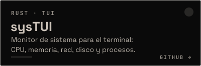</a></td>
    <td width="50%"><a href="https://github.com/AdriLabTech/FileTUI">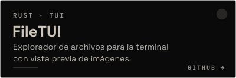</a></td>
  </tr>
  <tr>
    <td width="50%"><a href="https://github.com/AdriLabTech/TUI-OS_Arching">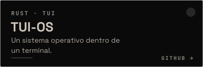</a></td>
    <td width="50%"><a href="https://github.com/AdriLabTech/N-Sharp">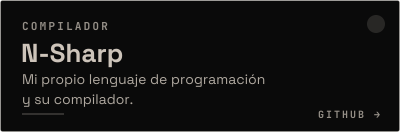</a></td>
  </tr>
  <tr>
    <td width="50%"><a href="https://github.com/AdriLabTech/ryoku-transit">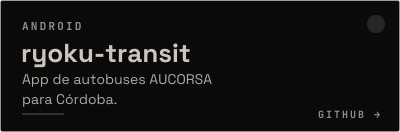</a></td>
    <td width="50%"><a href="https://github.com/AdriLabTech/claude-companion">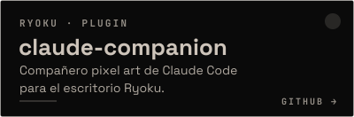</a></td>
  </tr>
</table>

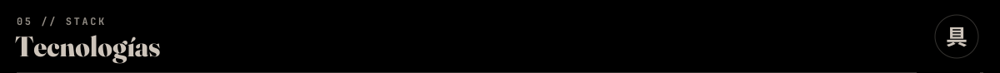

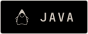
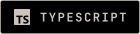

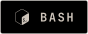

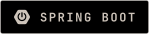

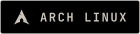
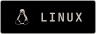
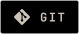

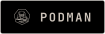

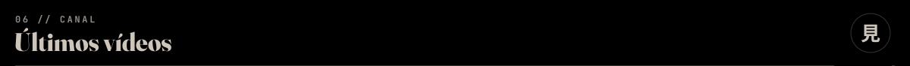

<!-- BEGIN YOUTUBE-CARDS -->
[")](https://www.youtube.com/watch?v=E7WRgTmJlFk)
[")](https://www.youtube.com/watch?v=gwxASXemMm0)
[")](https://www.youtube.com/watch?v=2KalGDNjn50)
[")](https://www.youtube.com/watch?v=0d2ce4RNgbQ)

<!-- END YOUTUBE-CARDS -->

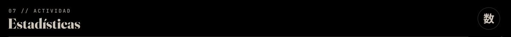

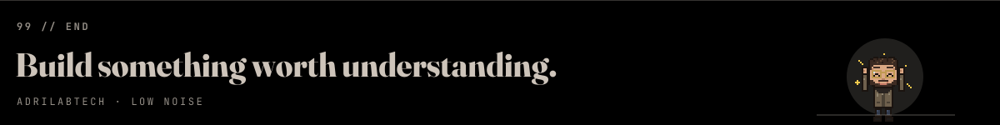
